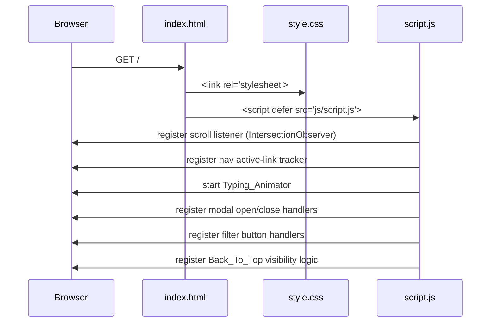

# Design Document: Komala Portfolio

## Overview

Komala Portfolio is a single-page static website delivered as plain HTML5, CSS3, and Vanilla JavaScript with zero build-time dependencies. The site presents Komala P's academic background, skills, and projects through a futuristic glass-morphism aesthetic and is deployed directly to GitHub Pages by pushing the repository root.

The design prioritises:
- **Zero-dependency runtime** — no npm, no bundler, no CDN framework, just three files loaded by the browser.
- **Progressive enhancement** — the page is readable without JavaScript; JS adds animations and interactivity.
- **Accessibility-first** — semantic HTML, ARIA attributes, keyboard focus trapping, and `prefers-reduced-motion` support are baked in from the start, not bolted on.

---

## Architecture

The site follows a classic static-page architecture. All logic is self-contained.

```
Komala-Portfolio/
├── index.html               # Single HTML document, all sections
├── css/
│   └── style.css            # All styles, design tokens, responsive breakpoints
├── js/
│   └── script.js            # All interactive behaviour
├── assets/
│   ├── images/              # profile photo (placeholder), project screenshots
│   └── documents/
│       └── resume.pdf       # (placeholder — file replaced by owner)
└── README.md
```

### Runtime Flow



### Key Design Decisions

1. **`defer` script loading** — `script.js` is loaded with `defer` so it runs after HTML parsing; no DOMContentLoaded wrapper needed.
2. **CSS custom properties (variables)** — all design tokens (colors, spacing, radii) live in `:root` so the theme can be updated in one place.
3. **IntersectionObserver for scroll reveal** — avoids the cost of scroll event listeners; entries are unobserved after first reveal.
4. **Single modal element, data-driven** — one `<dialog>` element is reused for both education and project modals; content is injected by JS from a `data-` attribute payload on each card.
5. **`<dialog>` element** — leverages the native HTML dialog for built-in accessibility semantics (`role="dialog"`, focus management on open), polyfilled only if needed.

---

## Components and Interfaces

### 1. Navigation (`<header>` + `<nav>`)

| Attribute | Value |
|---|---|
| Position | `position: fixed; top: 0` |
| Breakpoint | Hamburger at `< 768 px` |
| Active tracking | IntersectionObserver on each `<section>` |

The nav exposes a `setActiveLink(sectionId)` function called by the scroll observer. The hamburger toggle button has `aria-expanded` updated on each click.

```
Nav
├── .logo                      "K"
├── .nav-links  (ul)
│   └── li > a[href="#section-id"]  × 7 links
└── .hamburger  button[aria-expanded][aria-label]
```

### 2. Hero Section

```
#hero  (section)
├── .hero-photo  img[alt="Photo of Komala P — placeholder"]
├── h1              "Komala P"
├── .typing-text    span#typed-role  (mutated by Typing_Animator)
└── .cta-buttons
    ├── a[href="#projects"]   "Explore Projects"
    ├── a[href="#about"]      "About Me"
    ├── a[href="#contact"]    "Contact Me"
    └── a[href="assets/documents/resume.pdf"][download]  "Download Resume"
```

The resume link degrades gracefully: if the file is absent the link still renders with an `aria-label` explaining it is a placeholder.

### 3. Typing Animator (JS module pattern)

```js
// Public interface
TypingAnimator.init(elementId, strings, typingSpeed, pauseDuration)
TypingAnimator.stop()
```

Internally uses `setTimeout` chains. Respects `window.matchMedia('(prefers-reduced-motion: reduce)')` — if true, sets the inner text to `strings[0]` and returns immediately.

### 4. Scroll Reveal

A single `IntersectionObserver` watches all elements with `class="reveal"`. When an element's intersection ratio crosses the threshold:
1. Add `class="visible"` (triggers CSS transition).
2. Unobserve the element (one-time animation).

When `prefers-reduced-motion` is active, the observer adds `visible` synchronously during initialization without scheduling a transition.

### 5. Modal System

One `<dialog id="detail-modal">` element lives at the bottom of `<body>`.

```
#detail-modal  dialog[role="dialog"][aria-modal="true"][aria-labelledby="modal-title"]
├── .modal-header
│   ├── h2#modal-title
│   └── button.modal-close[aria-label="Close"]
└── .modal-body   (innerHTML replaced on open)
```

**Opening sequence:**
1. Populate `#modal-title` and `.modal-body` from the triggering card's `data-modal-content` (JSON string).
2. Store `document.activeElement` as `previousFocus`.
3. Call `dialog.showModal()` — browser handles `inert` + backdrop.
4. Attach keydown listener for focus trap and Escape.

**Closing sequence:**
1. Call `dialog.close()`.
2. Restore focus to `previousFocus`.
3. Remove keydown listener.

**Focus trap:** On `keydown Tab`, query all focusable children inside the dialog; cycle between first and last.

### 6. Project Filter

```js
FilterController.init(filterBarId, cardContainerId)
// Clicking a button sets data-active on the button and
// toggles card visibility via aria-hidden + CSS display
```

Cards are tagged with `data-category="Web|Hardware|Concepts|Software"`. The "All" button clears the active filter.

### 7. Back-to-Top Button

```
button#back-to-top[aria-label="Back to top"]
```

A scroll event listener (throttled with `requestAnimationFrame`) toggles class `visible` when `window.scrollY > 300`. Click handler calls `window.scrollTo({ top: 0, behavior: 'smooth' })`.

---

## Data Models

All dynamic content (project details, education entries) is encoded directly in the HTML via `data-` attributes so the page works without a network request or a JS data file.

### Education Entry (on `.education-card`)

```html
<article class="education-card"
  data-modal='{"title":"BE — Computer Science and Engineering","institution":"...","year":"3rd Year, 5th Semester","score":"CGPA 8.29","details":"..."}'>
```

| Field | Type | Notes |
|---|---|---|
| `title` | string | Degree / level name |
| `institution` | string | Full institution name |
| `year` | string | Current year / semester |
| `score` | string | CGPA or percentage as a string |
| `details` | string | Extended description shown in modal |

### Project Entry (on `.project-card`)

```html
<article class="project-card" data-category="Web"
  data-modal='{"title":"Guardian Circle","category":"Web","description":"...","technologies":["HTML","CSS","JS"],"status":"Concept / Design Project","hasLiveUrl":false,"hasRepoUrl":false}'>
```

| Field | Type | Notes |
|---|---|---|
| `title` | string | Project name |
| `category` | string | `"Web" \| "Hardware" \| "Concepts" \| "Software"` |
| `description` | string | Full project description |
| `technologies` | string[] | Stack / tools used |
| `status` | string | e.g., `"Concept / Design Project"` or `"Future Concept"` |
| `hasLiveUrl` | boolean | If false, no live URL is rendered |
| `hasRepoUrl` | boolean | If false, no repo URL is rendered |

### Achievement Entry (future, in HTML)

```html
<article class="achievement-card"
  data-title="Certification Name"
  data-org="Issuing Organisation"
  data-date="YYYY-MM">
```

Currently the section renders only an empty-state `<p>`.

### CSS Design Tokens (`:root`)

```css
:root {
  /* Colors */
  --bg-primary:      #0a0e1a;
  --bg-secondary:    #0f1629;
  --accent-blue:     #00d4ff;
  --accent-pink:     #ff006e;
  --text-primary:    #e8eaf6;
  --text-secondary:  #94a3b8;

  /* Gradients */
  --gradient-main:   linear-gradient(135deg, #7c3aed, #00d4ff);
  --gradient-card:   linear-gradient(135deg, rgba(0,212,255,0.05), rgba(124,58,237,0.05));

  /* Glass */
  --glass-bg:        rgba(15, 22, 41, 0.7);
  --glass-border:    rgba(0, 212, 255, 0.15);
  --glass-blur:      blur(12px);

  /* Timing */
  --transition-fast: 200ms ease;
  --transition-base: 300ms ease;
  --transition-slow: 400ms ease;

  /* Layout */
  --section-padding: clamp(4rem, 8vw, 8rem) 1.5rem;
  --card-radius:     1rem;
  --max-width:       1200px;
}
```

### Responsive Breakpoints

| Name | Range | Layout change |
|---|---|---|
| Mobile | `< 768 px` | Single column, hamburger nav |
| Tablet | `768 px – 1024 px` | Two-column grids |
| Desktop | `> 1024 px` | Full multi-column, sticky nav at full width |

---

## Correctness Properties

*A property is a characteristic or behavior that should hold true across all valid executions of a system — essentially, a formal statement about what the system should do. Properties serve as the bridge between human-readable specifications and machine-verifiable correctness guarantees.*


### Property 1: Scroll reveal adds visible class on viewport entry

*For any* element with class `reveal`, once its bounding box crosses the configured IntersectionObserver threshold, the class `visible` must be present on that element and must never be removed (one-time reveal).

**Validates: Requirements 12.1**

---

### Property 2: Reduced-motion disables scroll reveal transitions

*For any* page load where `prefers-reduced-motion: reduce` is active, all elements with class `reveal` must already have class `visible` set during initialization — no deferred or transition-based application.

**Validates: Requirements 12.2, 16.6**

---

### Property 3: Category filter shows only matching cards

*For any* filter category string (other than "All"), every project card that is not hidden must have a `data-category` attribute equal to the selected filter value; no card with a different category may be visible.

**Validates: Requirements 7.3**

---

### Property 4: Active nav link tracks the visible section

*For any* section identifier that is currently the most-intersecting section in the viewport, exactly one nav link — the one whose `href` matches that section's `id` — must carry the active CSS class, and all other nav links must not carry it.

**Validates: Requirements 3.4**

---

### Property 5: Typing animator loops through all strings

*For any* non-empty array of role strings, after the animator has completed one full cycle (displayed and erased every string once), the next string to begin typing must be `strings[0]` — demonstrating modulo-index cycling.

**Validates: Requirements 13.4, 2.3**

---

### Property 6: Typing animator respects timing invariants

*For any* run of the typing animator with a configured typing speed `T` ms and pause duration `P` ms (≥ 1500 ms), each character addition must be separated by approximately `T` ms, and the delay between full display and the start of erasing must be ≥ `P` ms.

**Validates: Requirements 13.1, 13.2**

---

### Property 7: Back-to-top button visibility follows the 300 px threshold

*For any* `window.scrollY` value, the back-to-top button must be visible (CSS class `visible` present) if and only if `scrollY > 300`.

**Validates: Requirements 11.1, 11.2**

---

### Property 8: Modal traps keyboard focus within its boundary

*For any* open modal, pressing Tab must move focus to the next focusable element inside the modal, and pressing Shift+Tab from the first focusable element must wrap focus to the last — focus must never leave the modal's DOM subtree while it is open.

**Validates: Requirements 5.5, 7.8**

---

### Property 9: Modal close restores focus to the triggering element

*For any* modal opened by activating a card element (via click or keyboard), closing the modal — whether by pressing Escape or clicking the close button — must return `document.activeElement` to exactly the card element that triggered the open.

**Validates: Requirements 5.6, 5.7, 7.9**

---

### Property 10: All interactive elements are keyboard reachable

*For any* interactive element (button, link, or form control) rendered in the document, the element must have a non-negative `tabIndex` and must be reachable via sequential Tab navigation without requiring a mouse interaction first.

**Validates: Requirements 15.3**

---

## Error Handling

### Missing Resume File

The `assets/documents/resume.pdf` placeholder may not exist during development. The `<a>` element is rendered unconditionally; its `aria-label` reads: "Download Resume — file not yet available, replace assets/documents/resume.pdf". No JS check is performed at load time (avoids a HEAD request); the visible link text itself includes a note: "Download Resume (placeholder)".

### Missing Profile Photo

The `` for the profile photo has `alt="Photo of Komala P — placeholder image"` and a CSS fallback background that draws the placeholder circle with instructional text using `::after` pseudo-content, so broken-image icons never appear.

### Invalid / Missing Modal Data

If `data-modal` JSON on a card fails to parse, the modal opens with a generic error message: "Details unavailable — please check the data-modal attribute." This prevents a silent white modal or JS crash.

### Filter with No Matching Cards

If a filter button is clicked and zero cards match the category, the container renders an inline empty-state `<p aria-live="polite">No projects in this category yet.</p>` rather than showing a blank grid.

### Escape Key Without Open Modal

The keydown handler for Escape is attached only while a modal is open (added on `showModal`, removed on `close`) so it does not interfere with other keyboard interactions on the page.

---

## Testing Strategy

### Dual Testing Approach

Both unit tests and property-based tests are required. They are complementary:

- **Unit tests** verify specific examples, edge cases, and integration points (DOM structure checks, content accuracy, ARIA attribute presence).
- **Property-based tests** verify that universal rules hold across a wide range of generated inputs (animation timing, filter logic, focus trapping).

### Property-Based Testing

**Library:** [fast-check](https://github.com/dubzzz/fast-check) (JavaScript, browser and Node compatible, MIT licence).

Each property test must run a **minimum of 100 iterations**. Each test must carry a comment tag in the format:

```
// Feature: komala-portfolio, Property N: <property text>
```

| Property | Test description | fast-check arbitraries |
|---|---|---|
| P1 — Scroll reveal | Generate N random `.reveal` elements; fire IntersectionObserver callback; assert all have `visible` class | `fc.array(fc.record({id: fc.string()}), {minLength:1})` |
| P2 — Reduced motion reveal | Same setup with `matchMedia` mocked to `reduce`; assert `visible` set synchronously | Same as P1 + mocked media query |
| P3 — Category filter | Generate random category strings and card sets; click filter; assert only matching cards visible | `fc.constantFrom('Web','Hardware','Concepts','Software')`, `fc.array(fc.record({category: fc.constantFrom(...)}))` |
| P4 — Active nav link | Generate random section intersection states; assert exactly one active link | `fc.constantFrom('hero','about','education','skills','projects','achievements','contact')` |
| P5 — Typing loop | Generate arrays of 1–10 random strings; run one full animator cycle; assert next index === 0 | `fc.array(fc.string({minLength:1}), {minLength:1, maxLength:10})` |
| P6 — Typing timing | Run animator with random `T` and `P`; assert character delays ≈ T, pause ≥ P | `fc.integer({min:50,max:200})` for T, `fc.integer({min:1500,max:3000})` for P |
| P7 — Back-to-top threshold | Generate random scrollY values; assert button visibility === (scrollY > 300) | `fc.integer({min:0, max:5000})` |
| P8 — Focus trap | Open modal with random focusable child counts; simulate Tab/Shift+Tab; assert focus stays inside | `fc.integer({min:2, max:10})` focusable elements |
| P9 — Focus restore | Open modal from random card index; close via Escape or close button; assert `activeElement` === card | `fc.boolean()` (Escape vs close-button), random card set |
| P10 — Keyboard reach | Generate full document DOM; query all interactive elements; assert all have tabIndex ≥ 0 | DOM introspection, no arbitraries needed |

### Unit Tests

Unit tests use a lightweight test runner (e.g., [uvu](https://github.com/lukeed/uvu) or plain Node `assert` with `jsdom`):

| Test | Requirement |
|---|---|
| Hero section contains name "Komala P" as `<h1>` | 2.2 |
| Hero photo `` has non-empty `alt` | 15.2 |
| Resume link points to `assets/documents/resume.pdf` | 2.9 |
| Nav contains exactly 7 links with correct labels | 3.2 |
| Education cards display correct institution, year, and score data | 5.1–5.3 |
| Skills section contains no `<progress>`, no `%` text, no star elements | 6.2 |
| Project cards for Guardian Circle, CivicPulse, FocusBank contain concept labels | 7.6, 7.7 |
| Guardian Circle, CivicPulse, FocusBank cards have `hasLiveUrl: false` | 7.6, 7.7 |
| Achievements section initially shows empty-state paragraph | 8.1 |
| Modal `<dialog>` has `role="dialog"`, `aria-modal="true"`, `aria-labelledby` | 15.5 |
| Contact section contains no non-placeholder real URLs | 9.4 |
| Footer copyright text matches "© 2025 Komala P" | 10.2 |
| Reduced motion: typing animator sets static text and returns | 13.5 |
| "All" filter makes all project cards visible | 7.4 |
| Back-to-top click calls `window.scrollTo` with `top: 0` | 11.3 |
